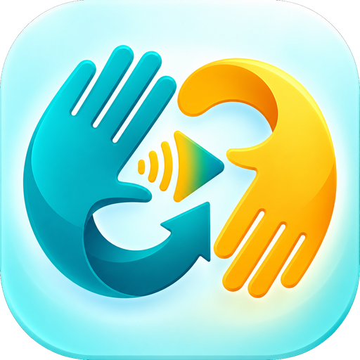

# Mira&Tek · Lengua de Señas Mexicana



Proyecto de **Technovation Girls 2026**. Una app de **Android** reconoce señas de la Lengua de Señas
Mexicana (LSM) con la cámara del celular y las convierte en texto y voz. Funciona **sin internet**.

- **Palabras:** Hola, Gracias, Por favor, Sí, No, Ayuda, Agua, Comida, Baño, Doctor, Familia, Amigo, Disculpa, Te quiero.
- **Abecedario:** A–Z y Ñ. Las letras se juntan en palabras (H-O-L-A → HOLA).
- **Números:** como en LSM, del 0 al 19, las decenas y el 100 tienen su propia seña; la app arma el
  resto (20 y luego 3 → 23; 100, 20 y 5 → 125).

El modelo se entrena en una **PC con Windows** usando `MiraTek.exe`, una app de escritorio que cualquier
persona puede usar con un botón.

## Cómo funciona el proyecto

```
 Personas que graban (PC)          Quien coordina (PC)                    Celulares (Android)
 ┌───────────────────────┐        ┌──────────────────────────────┐        ┌────────────────────┐
 │ MiraTek.exe           │  .zip  │ MiraTek.exe                  │  .json │ Mira&Tek (APK)     │
 │ 1. Grabar señas       │ ─────▶ │ 3. Abrir archivos recibidos  │ ─────▶ │ Reconoce en vivo,  │
 │ 2. Entrenar y probar  │        │ 4. Entrenar con todas        │  o APK │ arma frases y las  │
 │ 3. Enviar archivo     │        │ 5. Archivo para el celular   │        │ lee en voz alta    │
 └───────────────────────┘        └──────────────────────────────┘        └────────────────────┘
```

## Para quienes graban (sin conocimientos técnicos)

1. Abre **MiraTek.exe**. Si Windows muestra «Windows protegió su PC», elige **Más información →
   Ejecutar de todas formas** (pasa con cualquier programa nuevo sin firma).
2. Escribe tu nombre.
3. En **Grabar**, presiona **Empezar a grabar**. La app te guía: cuenta regresiva, haces la seña una vez
   y guarda sola. Si un clip sale mal, presiona **Borrar último**.
4. Puedes grabar por partes: tu avance se guarda solo. Grabar todo (67 señas × 15 clips) toma alrededor
   de una hora; también puedes grabar solo una categoría.
5. En **Entrenar**, presiona **Entrenar modelo** y luego **Probar** para verlo en vivo.
6. En **Compartir**, presiona **Crear archivo para enviar** y manda ese archivo (queda en tu Escritorio)
   por WhatsApp, correo o USB a quien coordina.

Consejos: buena luz de frente, a un brazo de distancia, con las manos y la cara dentro del cuadro.
Solo se guardan las posiciones de las manos, **nunca video ni fotos**.

Mensaje sugerido para mandar junto con el `.exe`:

> ¡Hola! Te comparto Mira&Tek para grabar señas. Ábrelo (si Windows avisa, elige «Más información →
> Ejecutar de todas formas»), escribe tu nombre y sigue los pasos de «Grabar». Al terminar, en
> «Compartir» presiona «Crear archivo para enviar» y mándame el archivo que aparece en tu Escritorio. ¡Gracias!

## Para quien coordina

1. En **Compartir → Abrir archivos recibidos**, abre los `.zip` de todas las personas. Las grabaciones
   se juntan sin duplicados.
2. En **Entrenar**, entrena con todas. Con 2 o más personas, la app hace un **examen honesto**: aprende
   sin una persona y trata de reconocerla, como si fuera alguien nuevo. Ese es el porcentaje que importa.
3. Lleva el modelo a los celulares, de una de dos formas:
   - **Archivo para el celular** (Compartir): se manda por WhatsApp y se abre desde la app de Android
     (Ajustes → Cargar modelo, o tocando el archivo y eligiendo Mira&Tek).
   - **APK con el modelo incluido:** doble clic en `Construir apk.bat` → `dist/MiraTek.apk`.
4. Para instalar la APK, pásala al celular y permite «instalar apps de origen desconocido».

> ⚠️ La primera vez, `Construir apk.bat` crea la llave de firma en `android/keystore/`. **Guárdala.**
> Sin ella no se puede actualizar la app ya instalada (habría que desinstalarla primero). No se sube a GitHub.

## App de Android

Cuatro secciones en el menú de abajo:

- **Traductor:** la cámara ocupa casi toda la pantalla para que te veas completo. Modos **Palabras**,
  **Deletreo** y **Números** (cada modo solo compite contra su categoría: una «O» nunca se confunde con
  el «0»), frase en una barra delgada y botón **Leer en voz alta** (voz del teléfono, sin internet).
- **Aprender:** cada seña con una animación grabada por el equipo (se ve como en un espejo), cómo se hace
  y **Practicar con la cámara**: la app te dice si la hiciste bien.
- **Perfil:** nombre, nivel según las señas practicadas y los planes (Inclusión, Pro y Aliado). Por ahora
  los planes solo se muestran: no hay cobros (la app no usa internet ni servidores).
- **Ajustes:** cargar modelo, sensibilidad, cámara y lectura automática.

No pide permiso de internet: la cámara nunca sale del teléfono.

**Instrucciones de las señas:** están en `assets/senas_info.json` (las usan la PC y el celular). Se
generan con `tools/make_signs_info.py`: las de Keysita van tal cual y el resto se redactó a partir del
Diccionario de Lengua de Señas Mexicana «Manos con Voz» (SEP/CONAPRED). Faltan **Hola**, **Doctor**,
**Disculpa** y **0**, que no vienen en ese diccionario: mientras, la app muestra su animación.

## Para desarrollar

Requisitos: Windows, Python 3.12+ y, para la APK, JDK 17 y el Android SDK. Con `scoop`:

```bash
scoop bucket add java
scoop bucket add extras
scoop install temurin17-jdk android-clt
sdkmanager --licenses
sdkmanager "platform-tools" "platforms;android-35" "build-tools;35.0.0"
```

```bash
python -m venv .venv
.venv\Scripts\pip install -r requirements.txt -r requirements-dev.txt
.venv\Scripts\python app.py --demo        # cámara simulada, útil sin webcam
.venv\Scripts\python -m pytest            # pruebas de Python
```

| Tarea | Comando |
|---|---|
| Construir `dist/MiraTek.exe` (incluye autoprueba) | `Construir exe.bat` |
| Construir `dist/MiraTek.apk` con el modelo de esta PC | `Construir apk.bat` |
| Pruebas de Android (incluye paridad con Python) | `cd android` y `gradlew testDebugUnitTest` |
| Capturas de pantalla de la PC | `.venv\Scripts\python tools\screenshots.py capturas` |
| Capturas de pantalla de Android (sin celular) | `cd android` y `gradlew recordPaparazziDebug` |
| Regenerar íconos desde `assets/logo.png` | `.venv\Scripts\python tools\make_assets.py` |

**Agregar una seña:** súmala a `SIGNS` en `miratek/config.py`, grábala y vuelve a entrenar. El celular
toma la lista de señas del archivo del modelo, así que no hay que cambiar la app de Android.

**Paridad PC ↔ celular:** `miratek/features.py`, `recognizer.py` y `phrase.py` tienen copias exactas en
`android/app/src/main/java/mx/miratek/senas/core/`. Si cambias una, cambia la otra, corre
`tools/make_parity_vectors.py` y las pruebas de Android. Las pruebas fallan si los resultados no coinciden.

### Cómo reconoce las señas

1. **MediaPipe** encuentra 21 puntos por mano, en la PC y en el celular.
2. Una ventana de ~2 segundos se convierte en 728 números: la forma 3D de la mano (relativa a la muñeca y
   al tamaño de la palma), la trayectoria del movimiento y la posición. Si la seña la hace la mano
   izquierda, se refleja como espejo, así funciona para personas zurdas y diestras.
3. Una red neuronal pequeña (MLP escrita con NumPy) da la probabilidad de cada seña. La confianza se
   calibra para que «80 %» signifique de verdad 80 %.
4. En vivo, las probabilidades se suavizan y una seña solo se confirma si gana varias veces seguidas.
   La clase **«Nada»** evita que «adivine» cuando no estás haciendo ninguna seña.

### Estructura

```
app.py                  arranque de la app de PC
miratek/                núcleo (características, modelo, entrenamiento) e interfaz (miratek/ui)
android/                app de Android (Kotlin + Jetpack Compose + CameraX + MediaPipe)
assets/                 logo, íconos y el detector de manos de MediaPipe
tests/                  pruebas de Python
tools/                  construir .exe/.apk, íconos, capturas y datos de paridad
```

## Límites

- El modelo solo es tan bueno como sus grabaciones: graben **varias personas** (mínimo 3, ideal 5+) y
  pidan a alguien que sepa LSM que revise cómo se hace cada seña.
- Las señas se reconocen de una en una (no frases continuas rápidas). Al deletrear, mantén cada letra
  aproximadamente un segundo.
